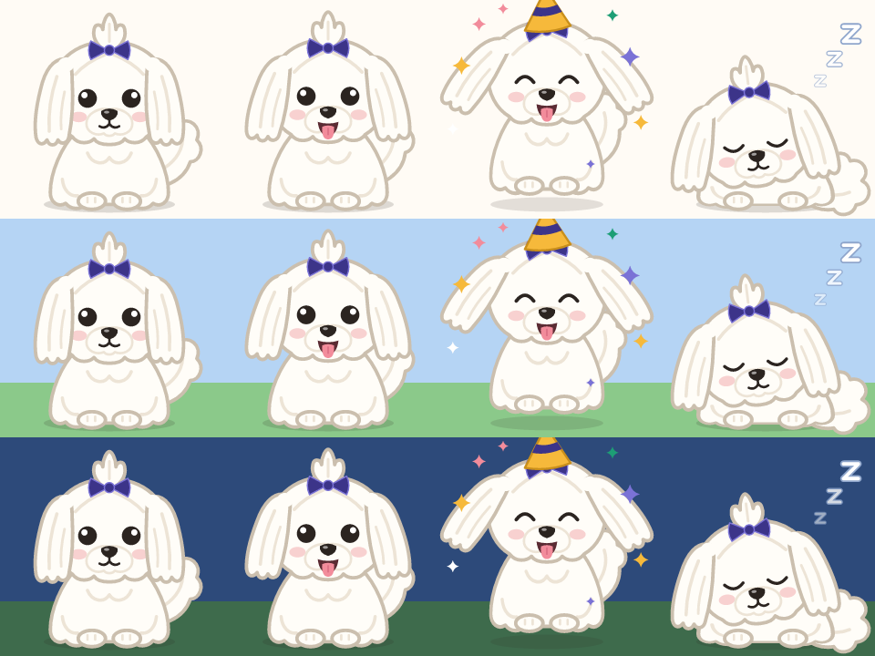
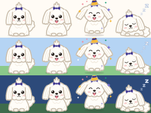
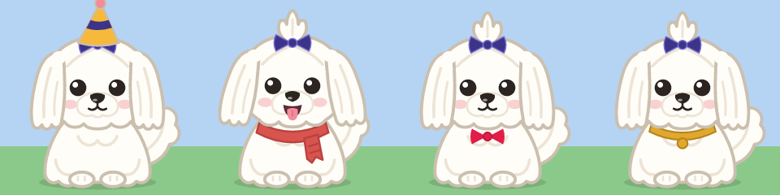
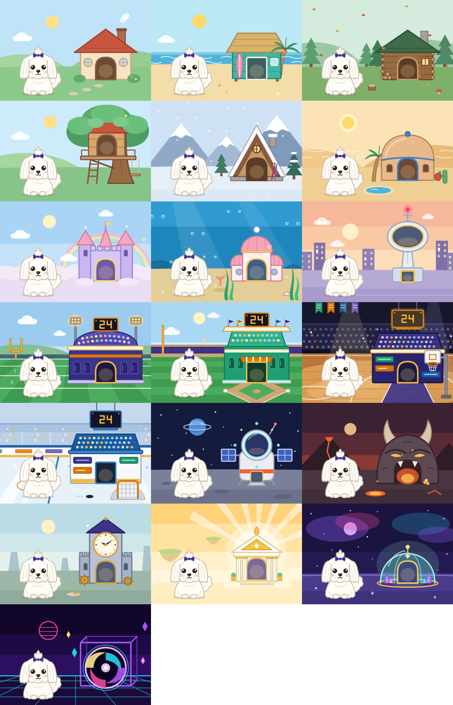

# COMPANION.md — the Maltese

The companion is an original Maltese puppy, drawn entirely in code as SVG
shapes and animated with Reanimated. There are no image files, fonts, or
Lottie files behind her. She keeps whatever name the user chose
(`settings.companion_name`, default "Nova").

Code: `app/components/companion/`. Review screen: Settings → Companion Gallery.

## What she looks like

Every state (columns: idle, happy, celebrating, sleeping) on every background
the app uses (rows: warm white `#FFFBF5`, day sky and grass, night sky and
grass), at 240px:



The same grid at 64px, the smallest size she is meant to work at:



The shop items the rig can draw today (party hat, scarf, bow tie, golden collar):



Single images, one per state, background, and size, are in
[`docs/companion/`](companion/), named `<state>-<background>-<size>.png`
(for example [`idle-warmWhite-64.png`](companion/idle-warmWhite-64.png),
[`sleeping-night-240.png`](companion/sleeping-night-240.png)).

These pictures are the **key pose** of each state: the pose the animation
moves around. They are made from the same shape data and the same pose math
the phone uses, so they show the drawing faithfully. They cannot show motion.

To regenerate them after changing the drawing:

```powershell
npm run render:companion
```

## Design rationale

**Shapes.** Everything is a chunky, rounded blob: a big head (about 55% of her
height with the topknot), a small bell-shaped body, two round paws. Fur is
drawn as a few large scallops (the chin, the ear tips, the coat hem, the tail
plume), never as individual hairs. Detail is kept to what survives at 64px:
two eyes, a nose, a bow.

**What makes her a Maltese** rather than a generic white dog:
- a long white coat that flares to the floor
- long, silky ears that hang beside the face and blend into the head at the
  top (a fur-colored patch hides the seam, so they read as hair, not flaps)
- a centre parting in the hair on the forehead
- a topknot tied with a bow
- a plume tail curled up behind her
- round black eyes and a small black button nose, set low on the face

**Palette** (all in `palette.ts`). Flat color with one shade tone per area.

| Use | Color |
|---|---|
| Fur | `#FFFDF8` |
| Fur shade (fold lines, muzzle edge) | `#EDE4D6` |
| Outline | `#CBBFAE` |
| Eyes, nose, mouth line | `#2B2420` |
| Eye highlight | `#FFFFFF` |
| Tongue | `#F28C9B` |
| Blush | `#F7C9C9` |
| Bow | `#3C3489` (brand purple), with a thin `#7A72D6` edge |

**The white-on-white problem.** A white dog on a warm white screen disappears.
Three things keep her visible:
1. A soft warm-grey outline around every large shape. It is 3.2 drawing units
   wide, which is about 2.4px at the 150px yard size.
2. A ground shadow ellipse under her feet. It shrinks and fades when she jumps.
3. The outline gets proportionally thicker as she gets smaller (up to 1.7×
   at 64px), because a hairline outline at small sizes fades into the page.
   See `outlineScaleForSize()` in `poses.ts`.

The bow's light edge is there for the opposite case: brand purple on the
night sky (`#2D4A7A`) is low contrast without it.

**Originality.** She was designed from the breed's traits and the palette
above. No existing character, mascot, or app artwork was used as a reference
or imitated.

## How the drawing was reviewed

Nobody can see code, so `scripts/render-companion.mjs` turns the drawing into
PNGs, and each round was looked at and criticised before changing anything.

| Round | What was wrong | What changed |
|---|---|---|
| 1 | Body was a tall column and read as "lamb standing up". Ears were wide paddles that touched the eyes and read as rabbit ears. Outline too thin on white. | — |
| 2 | Fixed: body became a wide bell-shaped coat; ears slimmer and clear of the eyes; face moved lower on the head; bigger tail plume; thicker outline. New problem: a sliver of the open eye showed under the closed eyelid. Ears still looked stuck onto the head. | Body, ears, tail, face position |
| 3 | Fixed: ears blend into the head; outline scales up at small sizes. The eyelid sliver was smaller but still there (found by zooming in on the sleeping face). | Ear seam patch, outline scaling |
| 4 | Fixed: the eyelid cover is now a full circle larger than the eye. | Eyelids |

Remaining weak spots, judged from the renders:
- At 64px on warm white she is readable but pale. That is the nature of a
  white dog on a white page; the outline does the work.
- The tail is partly hidden behind the right ear when she sits facing you.
  It shows most clearly when it wags.
- The sleeping pose is the same parts squashed and rearranged, not a
  separately drawn curled-up dog. It reads as "lying down asleep".

## The rig

The dog is drawn in a 200 × 200 box. Each moving part is its own group of
shapes with a pivot: the point it rotates or scales around.

| Part | Pivot (x, y) | What moves it |
|---|---|---|
| Whole dog | 100, 150 | hops, the celebration spin and wiggle |
| Body | 100, 188 (the ground) | breathing, squash and stretch |
| Head | 100, 128 (the neck) | tilt, leaning into a petting hand. It also rides up and down with the body |
| Left ear / right ear | 58, 62 / 142, 62 (ear base) | flops, follow-through after hops |
| Tail | 132, 160 (tail base) | sway, wag, tuck when asleep |
| Topknot and bow | 100, 46 (the knot) | wobbles a beat after the head |
| Eyelids | y = 81 (top edge of the eyes) | blink, sleep |
| Mouth | 100, 113 | opens downward |
| Shadow | 100, 187 | shrinks and fades during a jump |

Files:

| File | Job |
|---|---|
| `palette.ts` | every color |
| `parts.ts` | the drawing, as shape data (paths, circles, ellipses) |
| `poses.ts` | the key pose of each state, the pivots, and `partTransform()`, which turns a pose into a transform for one part |
| `MalteseSvg.tsx` | draws the parts with `react-native-svg`. `<MalteseSvg>` is the whole dog standing still, every part in its own `<G>` |
| `useCompanionRig.ts` | Reanimated shared values and the loops for each state |
| `Companion.tsx` | the public component: stacks the parts as layers and animates them |
| `svgMarkup.ts` | the same drawing as an SVG string, for the render script |
| `haptics.ts` | the tap vibration, loaded so that it can never crash the app |

**How a frame is made.** A pose is 15 numbers (ear angles, tail angle, eyelid,
and so on). The pose on screen is the state's key pose plus small loop offsets
(breathing, wagging, hopping, blinking). Reanimated computes that sum on the
UI thread every frame. Each part is a see-through layer (an `Animated.View`
holding one SVG), and each layer turns its slice of the pose into a transform
around its pivot.

**Why layers of views, not animation inside one SVG.** Moving a view with a
transform is what Reanimated is built for: it runs on the UI thread and never
redraws the vector shapes. Animating attributes inside an SVG re-renders the
shapes each frame and is the less-travelled path. Since this could not be
tested on a phone during the build, the more reliable route was chosen. The
drawing is still one set of SVG parts, each in its own `<G>`.

## What each state does

| State | Motion |
|---|---|
| **idle** | Breathes (body ±2.5%, 3.2s cycle, the head rides with it). Blinks at a random interval of 2.5–6s, eyelids closed for 120ms. Slow tail sway. One ear flops every 6–10s. Head tilts about 6° every 7–12s, and the topknot follows a beat late. |
| **happy** | Mouth open, tongue out. Tail wags 3 times a second. Small hops with a crouch before and a squash on landing. Ears and topknot follow the head a moment later. Still blinks. |
| **celebrating** | Party hat on. Bigger jumps with a crouch first, a wiggle in the air, and a squash on landing. Ears pinned down on the ground and flying at the top. Eight sparkles pop outward and fade. Smiling "^ ^" eyes. The screen returns her to happy after 5 seconds. |
| **sleeping** | Lying down: body flattened, head resting low, eyes closed as curved lines, tail tucked along the ground. Breathing slowed to a 5s cycle. Three "z"s drift up and fade in a loop. |

**Changing state** never snaps: every pose value eases to the new pose over
340ms, and the hat fades in or out.

**Tap:** she squashes, pops back past her normal height, settles with a small
spring, and wiggles. A heart pops up and fades. The phone gives a light tick.

**Petting:** stroke sideways across her head for one second. She closes her
eyes into a smile, leans toward your finger, and wags until you lift it.
Only sideways strokes count, so dragging up or down still scrolls the page.

**Reduce Motion** (the phone's setting, or the switch in the Gallery): no
loops and no sparkles. She blinks at most once every 10 seconds. State changes
crossfade instead of moving. The "z"s are shown but do not move. A tap still
gives the heart (fading in place) and the tick.

**When the screen is not focused** (you are on another tab) all loops and
timers stop, and start again when you come back.

<!-- COMPANION_ADD: sections added by the wardrobe run, 2026-11-14 -->
## Breeds

There are six dogs. They share one skeleton (the same parts, the same rig,
the same animation) and differ only in their drawing, colors, and where
things hinge. Each is one file in `app/components/companion/breeds/`.

| Breed | File | What makes it read |
|---|---|---|
| Maltese | `maltese.ts` | white floor-length coat, long ears, topknot and bow |
| German Shepherd | `germanShepherd.ts` | tall pointed ears, dark cap and muzzle, brow dots, dark saddle |
| Golden Retriever | `goldenRetriever.ts` | gold coat, soft drop ears, pale chest, feathered tail |
| Corgi | `corgi.ts` | huge upright ears, white blaze and chest, wide body, nub tail |
| Shiba Inu | `shiba.ts` | cheek fluff, cream cheeks and brows, tail curled in a ring |
| Pug | `pug.ts` | wide head, big wide-set eyes, dark mask, folded ears, wrinkles |

All six side by side: `docs/companion/breeds/lineup.png`. Each breed's sheets
are in `docs/companion/breeds/<breed>/`.

The eyes, eyelids, nose, and mouth are built by one function
(`breeds/common.ts`, `buildFace()`), so every dog blinks and smiles the same
way and the family look stays consistent.

**To add a breed:** copy the closest existing file, change the drawing, add
it to the list in `breeds/index.ts`, and add its id to `BREED_IDS` in
`breeds/types.ts`. Run `npm run render:companion` and look at the sheets. The
tests pick the new breed up by themselves.

## What she wears

Every Outfit and Accessory in the Shop (30 items) can be worn. Each is drawn
once, in `items/itemArt.ts`, and every breed wears the same drawing.

**Slots.** She can wear one item in each of seven slots. Putting an item on
replaces whatever was in its slot. The table is `items/itemSlots.ts`.

| Slot | Where it sits | Items |
|---|---|---|
| outfit | on the body, clipped to the body shape | sweater, raincoat, vest, suits, armor, robe, coats |
| head | top of the head | party hat, flower crown, astral crown, cosmic halo |
| face | over the eyes | sunglasses |
| neck | under the chin | bow tie, collar, pendant, dragon charm, infinity gem |
| back | behind the body | superhero cape, wizard cloak, mythic mantle, celestial wings |
| held | in the right front paw | magic wand, elemental staff, omnipotent orb |
| aura | behind everything | legendary aura, arcane matrix |

**Anchors.** Each breed says where seven points are on its drawing: `headTop`,
`eyes`, `neck`, `chest`, `back`, `frontPaw`, `aura`. An item is moved to its
anchor, then drawn on the layer of the body part it belongs to. That layer
already follows the head, the body, or the paw, so the item moves with it.

**Draw order,** back to front: aura, back items, tail, body, outfit, neck
items, paws, head, face items, ears, head items, held items. One function
decides this for all three renderers (`scene.ts`, `buildScene()`).

**Effects.** The aura pulses, the halo and orb bob, the rune circle turns.
These stop under Reduce Motion.

**Review sheets:** `docs/companion/items/items-1.png` to `items-3.png` (every
item, idle and happy), `max-outfit.png` (one item in every slot, all four
states), and `max-outfit-64.png` (the same at the smallest size).

Follow-ups, not done in this run:
- Recoloring the Maltese's bow from a shop item.

<!-- COMPANION_ADD: sections added by the houses run, 2026-11-14 -->
## Houses

Every House item in the Shop (15) has its own drawing and its own backdrop.
The yard on Home shows the house picked with "Show in yard", or the best
house owned. With no house owned, the old starter yard is shown.

All fifteen, with the Maltese in front (rows are tiers 1 to 5):



The same with a dog resting inside: [`houses-inside.png`](companion/houses/houses-inside.png).
Other breeds, some fully dressed: [`houses-breeds.png`](companion/houses/houses-breeds.png)
and [`houses-breeds-inside.png`](companion/houses/houses-breeds-inside.png).
The Shop card size: [`houses-small.png`](companion/houses/houses-small.png).
One large picture per house: `docs/companion/houses/<house id>.png`.

Code: `app/components/companion/houses/`.

| File | Job |
|---|---|
| `types.ts` | what a house is (`HouseDef`), the ambient motion math, and how a scene is fitted into a view |
| `art.ts` | drawing helpers: sky, ground, hills, clouds, pines, palms, doorways |
| `tier1.ts` to `tier5.ts` | the drawings, three houses per file |
| `index.ts` | the list of houses and `getHouse(id)` |
| `HouseScene.tsx` | `<HouseScene>` (animated) and `<HouseStill>` (one still picture) |
| `houseMarkup.ts` | the same scene as SVG text, for the render script |

**A scene** is drawn in a 300 x 200 box and has four parts:

| Part | What it is | Moves? |
|---|---|---|
| backdrop | sky, ground, two or three scenery shapes | no |
| house | the building | no |
| ambient | small loops: smoke, waves, snow, stars, clock hands | yes |
| three points | where the dog stands, the door, where she rests inside | no |

**Ambient motion.** Each ambient element is its own see-through layer. Six
motions exist: `rise` (smoke, embers), `scroll` (snow, leaves, bubbles,
clouds), `sway` (palms, kelp, canopy, light rays), `spin` (clock hands,
portal, station lights), `pulse` (beacon, embers, stars), and `bob` (waves,
shimmer, floating shards). One clock drives them all. Under Reduce Motion,
and when Home is not the screen in front, the clock stops.

| House | What moves |
|---|---|
| Cozy Den | chimney smoke |
| Beach Shack | two rows of waves, the palm |
| Forest Cabin | falling leaves |
| Treehouse | the canopy |
| Mountain Lodge | two layers of snow |
| Desert Oasis | heat shimmer, the palm |
| Cloud Castle | drifting clouds, a twinkle |
| Underwater Palace | rising bubbles, kelp |
| Sky Tower | the beacon, clouds, city windows |
| Space Station | twinkling stars, a turning ring of lights |
| Dragon's Lair | the ember glow in the cave, rising embers |
| Time Fortress | the clock hands |
| Realm of the Gods | light rays, rising motes |
| Cosmic Sanctuary | the nebula, stars, the dome's glow |
| Dimension X | the portal swirl, its core, floating shards |

**To change a house:** edit its shapes in `tier<N>.ts`, run
`node --no-warnings scripts/render-companion.mjs docs/companion houses`, and
look at the sheets.

**How the house art was reviewed**

| Round | What was wrong | What changed |
|---|---|---|
| 1 | The resting dog was bigger than the doorways and covered their frames. The Beach Shack palm ran off the right edge. The Cozy Den smoke was too small to see. | (first render) |
| 2 | Fixed: she is drawn smaller inside (46 units, down from 56), so she sits within the door frame. Palm moved in. Bigger smoke puffs. Checked dark coats against dark doorways: the lamp glow in each doorway keeps them readable. | rest sizes, palm, smoke |

## How to change her

- **A color:** `palette.ts`, then `npm run render:companion` and look.
- **A shape:** the path in `breeds/<breed>.ts` (the dog) or `items/itemArt.ts` (what she wears). Paths use absolute `M L C Q Z` commands
  in the 200 × 200 box. The right ear, eye, and paw are mirrored from the left
  automatically.
- **A pose:** the numbers in `POSES` in `poses.ts`.
- **A loop's speed or size:** the constants at the top of `useCompanionRig.ts`
  and the keyframe lists inside the state branches.
- **Rollback to the old dog:** see D15 in `docs/DECISIONS.md`.
